# Pokémon Card PreGrader — A-Eye

**GitHub repository:** [schneider-thomas-unilu/pokemon-card-pregrader](https://github.com/schneider-thomas-unilu/pokemon-card-pregrader)

An AI-assisted prototype exploring how computer vision and image analysis can help Pokémon card collectors and resellers identify possible visible defects and decide whether professional grading may be worthwhile.

## Problem

Assessing card condition takes time, and professional grading costs money. This project explores whether vision AI can provide useful preliminary observations about:

- Centering
- Corner wear
- Edge wear
- Surface scratches
- Visible bending and creases
- Other visible issues, including stains and print defects

The goal is to support preliminary assessment, not replace professional grading.

## Project status

The project currently contains two related components:

**1. A-Eye application MVP**

A React + Vite frontend and FastAPI backend provide an interactive card-analysis workflow.

- Users upload a card photo or take one using their camera.
- The application checks basic photo quality and provides retake guidance.
- Users manually mark the card's outside corners and inner printed-border corners to estimate centering.
- Optional Gemini vision analysis identifies possible visible condition issues, with user confirmation before the photo is sent to the external provider.
- Gemini 3.8 Flash is the intended default model. Gemini 3.5 and 3.1 were also used for testing when 3.8 was unavailable or busy.

The application has successfully returned real AI-generated condition observations from card photos. This demonstrates a working AI integration, not validated grading accuracy.

**2. Separate AI experiment**

A reproducible Gemini API experiment is implemented for ten card photos and five reference categories. Its API run has not yet completed successfully following transient service timeouts.

A manual one-card pilot matched two reference labels but also reported two extra categories, giving 50% precision and 100% recall under one-person labels. This small pilot is not evidence of general accuracy.

## Repository structure

- [`app/`](app/README.md) — React + FastAPI application, Docker setup, and usage instructions.
- [`experiment/`](experiment/README.md) — separate AI experiment, reference labels, predictions, and evaluation instructions.
- [`docs/`](docs/README.md) — project documentation, architecture, decisions, costs, and submission information.

## Main documentation

- [Submission summary](docs/submission-summary.md)
- [Approach comparison](docs/approach-comparison.md)
- [Architecture overview](docs/architecture.md)
- [Application architecture diagram (SVG)](docs/architecture-diagram.svg)
- [Editable architecture diagram (Mermaid)](docs/architecture-diagram.mmd)
- [Cost estimate](docs/cost-estimate.md)
- [Decision and MVP plan](docs/decision-and-mvp-plan.md)



## Running the application

The recommended setup uses Docker Compose.

See **[app/README.md](app/README.md)** for:

- Windows and Docker Desktop prerequisites
- Installation and startup instructions
- Gemini API configuration
- Local development setup
- Application features and limitations

The application runs at `http://localhost:8080` by default.

The Docker setup has been successfully tested on a separate Windows laptop, including application startup, photo-quality checks, and centering analysis. Gemini API analysis on that laptop has not yet been independently verified.

## Running the separate experiment

The experiment is independent of the application and is not included in the app's Docker build or runtime.

From the repository root, install its dependencies:

```powershell
py -m pip install -r requirements.txt
```

Confirm that `experiment/cases.csv` lists the intended photos and `experiment/reference_defects.csv` contains reviewed reference labels.

Put your Gemini key in the ignored root `.env` file:

```text
API_KEY=your-gemini-api-key
```

Then run:

```powershell
py experiment/measure_centering.py --manifest experiment/cases.csv

py experiment/run_experiment.py --manifest experiment/cases.csv --references experiment/reference_defects.csv --centering-measurements experiment/centering_measurements.csv --overwrite
```

The centering tool asks the user to mark the four card corners and four visible inner-border corners. It rectifies perspective and calculates left:right and top:bottom border ratios without using AI.

The API runner saves progress after each card to `experiment/gemini_predictions.csv`. Per-category metrics are saved to `experiment/gemini_predictions_metrics.csv`.

The experiment also calculates a prototype condition score and produces a recommendation using fixed thresholds. This is an experimental heuristic, not an official grade or profit calculation.

For key setup, reruns, troubleshooting, and metric definitions, see the [detailed experiment instructions](experiment/README.md).

The notebook was developed in Google Colab. Its earlier manual ChatGPT-interface result was not an API experiment.

## Known limitations

- The manual pilot used one card and reference labels created by one person.
- The separate API experiment has not yet completed successfully.
- Manual corner placement can be imprecise and affect centering measurements.
- Gemini 3.8 Flash can be overloaded or temporarily unavailable, preventing or delaying AI analysis.
- Photo quality, lighting, glare, and viewing angle can affect defect observations.
- AI observations and confidence values are not validated grading assessments.
- A single front-facing photo cannot reveal all defects, particularly on the reverse side of a card.
- The application does not authenticate cards or guarantee resale value.

For more details, see the [application README](app/README.md).

## Next steps

- Interview resellers and record their decision thresholds.
- Gather permissioned card photos and independently agree reference labels.
- Complete the separate API experiment and record defect metrics, latency, and token usage.
- Improve centering through automatic boundary detection.
- Explore a photo-quality gate, marked-up results, and evidence-based grading recommendations.
- Follow the [named-owner MVP plan](docs/decision-and-mvp-plan.md) for target dates.

## Disclaimer

This project provides preliminary educational experimentation only. It does not provide official grading, authentication, or financial guarantees.
