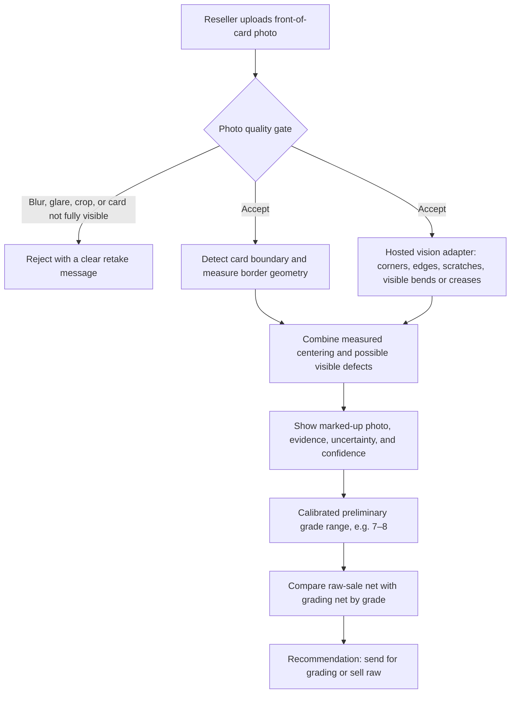

# First Architecture Sketch — Pokémon Card PreGrader

This is a first-pass design, not an implemented application. The checks and result calculations shown below are MVP work.



Centering is measured from the card and border geometry in code, not estimated by the vision model. The image-quality gate must refuse unusable photos instead of returning a success-shaped analysis. If the card boundary cannot be found reliably, ask the user to retake the photo.

## Result-screen sketch

```text
+----------------------------------------------------+
| [Card photo with suspected defect locations marked]|
|                                                    |
| Possible corner wear      confidence: medium       |
| Possible edge wear        confidence: low          |
| Possible surface scratch  confidence: medium       |
| Possible bend / crease   confidence: low          |
| Other visible issue      confidence: medium       |
| Centering measured from borders: within / off      |
|                                                    |
| Heuristic condition score: 9.2/10                |
| NOT AN OFFICIAL GRADE OR PROFIT ESTIMATE.          |
|                                                    |
| Sell raw: net €...                                 |
| Grade 7: net €...   Grade 8: net €...              |
| Recommendation: DO NOT BUY / SELL RAW / SUBMIT     |
+----------------------------------------------------+
```

Grade-range calibration requires professionally graded examples and must not be a free-form grade asserted by the language model. The current experiment's fixed-weight condition score and 9/10 decision threshold are only a prototype heuristic; they do not estimate grade or profit. A real profit comparison additionally needs user-supplied or sourced sale values, grading fee, shipping, and selling costs, with assumptions shown beside the recommendation.

## Components and responsibilities

- **Photo input and quality gate:** Check blur, glare, lighting, crop, and whether the full card is visible. Reject poor images with specific retake guidance.
- **Geometry module:** Find card and printed-border boundaries; calculate centering ratios and surface the measurement and its uncertainty.
- **Vision adapter:** Send the image to the selected API for qualitative corner/edge wear, scratches, visible bends or creases, and other visible issues such as stains, dents, discoloration, or print defects. Exclude ordinary card design and avoid double-counting named categories. Do not infer hidden bends from a straight-on photo; request angled/front-and-back photos for better assessment. Keep the API schema and provider-specific details isolated.
- **Result and calibration module:** Mark possible defects on the photo; show evidence, uncertainty, confidence, and a conservative grade range only after calibration.
- **Profit calculator:** Compare estimated net proceeds from selling raw versus grading and selling at each grade in the range.
- **Privacy and storage:** Minimize retention of uploaded photos, explain provider processing, and obtain consent before storing images for evaluation.

The model's self-reported confidence is not a verified probability. A straight-on photo can miss bends that are visible only at an angle or on the reverse, so an unavailable view must be shown as uncertain, not as evidence of a flat card. Never present the estimate as an official grade, guarantee, or substitute for professional grading.
